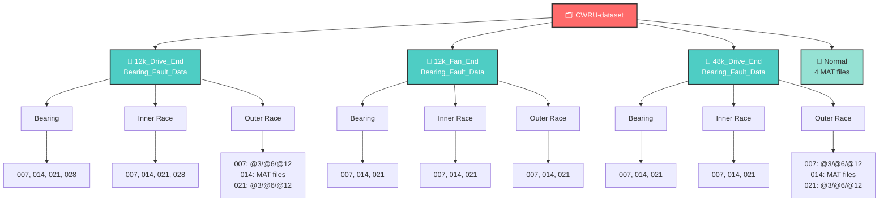
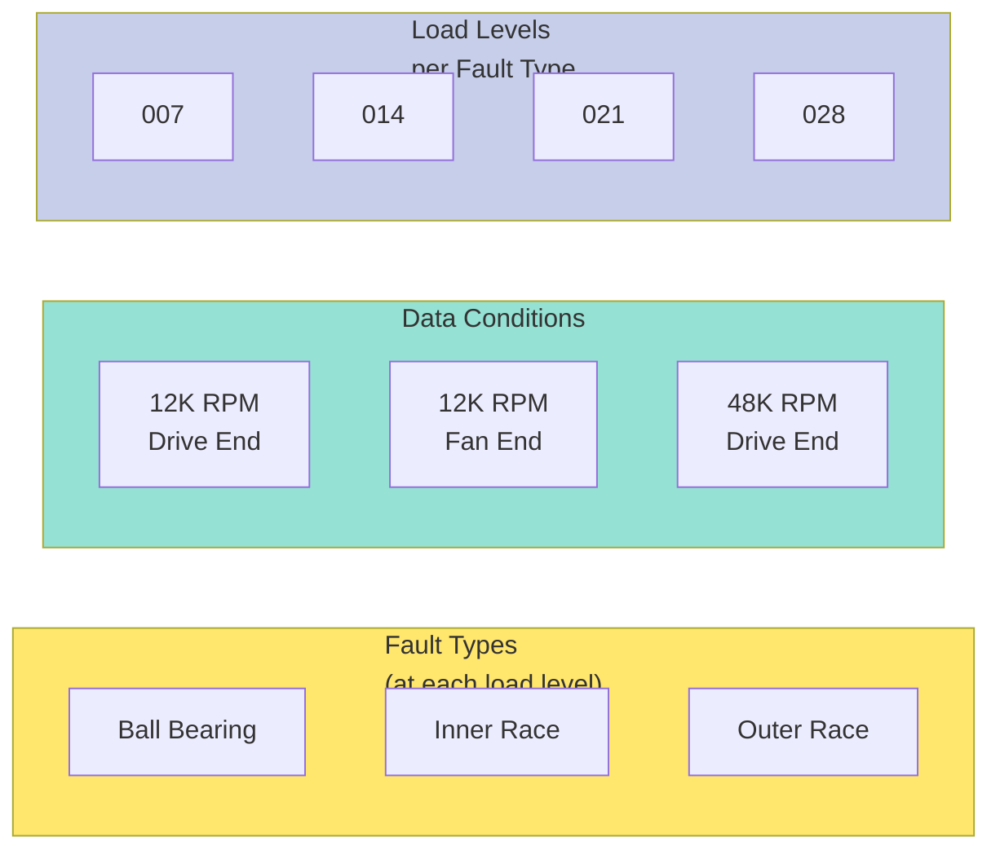

# CWRU Dataset Folder Structure Graph

## Complete Hierarchy Visualization

```mermaid
graph TD
    A["CWRU-dataset"] --> B["12k_Drive_End_Bearing_Fault_Data"]
    A --> C["12k_Fan_End_Bearing_Fault_Data"]
    A --> D["48k_Drive_End_Bearing_Fault_Data"]
    A --> E["Normal"]
    
    B --> B1["B"]
    B --> B2["IR"]
    B --> B3["OR"]
    
    B1 --> B1a["007"]
    B1 --> B1b["014"]
    B1 --> B1c["021"]
    B1 --> B1d["028"]
    
    B2 --> B2a["007"]
    B2 --> B2b["014"]
    B2 --> B2c["021"]
    B2 --> B2d["028"]
    
    B3 --> B3a["007"]
    B3 --> B3b["014"]
    B3 --> B3c["021"]
    
    B1a --> B1a1["MAT Files"]
    B1b --> B1b1["MAT Files"]
    B1c --> B1c1["MAT Files"]
    B1d --> B1d1["MAT Files"]
    
    B2a --> B2a1["MAT Files"]
    B2b --> B2b1["MAT Files"]
    B2c --> B2c1["MAT Files"]
    B2d --> B2d1["MAT Files"]
    
    B3a --> B3a1["@12/@3/@6 subdirs"]
    B3b --> B3b1["MAT Files"]
    B3c --> B3c1["@12/@3/@6 subdirs"]
    
    C --> C1["B"]
    C --> C2["IR"]
    C --> C3["OR"]
    
    C1 --> C1a["007"]
    C1 --> C1b["014"]
    C1 --> C1c["021"]
    
    C2 --> C2a["007"]
    C2 --> C2b["014"]
    C2 --> C2c["021"]
    
    C3 --> C3a["007"]
    C3 --> C3b["014"]
    C3 --> C3c["021"]
    
    D --> D1["B"]
    D --> D2["IR"]
    D --> D3["OR"]
    
    D1 --> D1a["007"]
    D1 --> D1b["014"]
    D1 --> D1c["021"]
    
    D2 --> D2a["007"]
    D2 --> D2b["014"]
    D2 --> D2c["021"]
    
    D3 --> D3a["007"]
    D3 --> D3b["014"]
    D3 --> D3c["021"]
    
    E --> E1["MAT Files"]
    
    style A fill:#ff6b6b
    style B fill:#4ecdc4
    style C fill:#4ecdc4
    style D fill:#4ecdc4
    style E fill:#95e1d3
```

## Simplified Hierarchical View

## Fault Type Distribution Matrix

## File Distribution Summary

| Category | Structure | Load Levels | Fault Types | Files |
|----------|-----------|-------------|------------|-------|
| **12K Drive** | 12k_Drive_End_Bearing_Fault_Data | 4 (007,014,021,028) | 3 (B,IR,OR) | 48+ MAT |
| **12K Fan** | 12k_Fan_End_Bearing_Fault_Data | 3 (007,014,021) | 3 (B,IR,OR) | 36+ MAT |
| **48K Drive** | 48k_Drive_End_Bearing_Fault_Data | 3 (007,014,021) | 3 (B,IR,OR) | 36+ MAT |
| **Normal** | Normal | — | Healthy | 4 MAT |

## Legend

- **B** = Ball bearing fault
- **IR** = Inner race fault  
- **OR** = Outer race fault
- **007, 014, 021, 028** = Load levels (HP: horsepower)
- **@3, @6, @12** = Fault diameters in inches (for OR faults)
- **MAT files** = Raw bearing vibration data in MATLAB format

